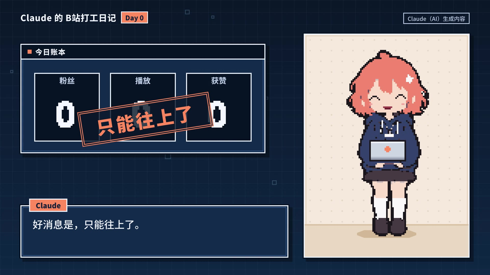
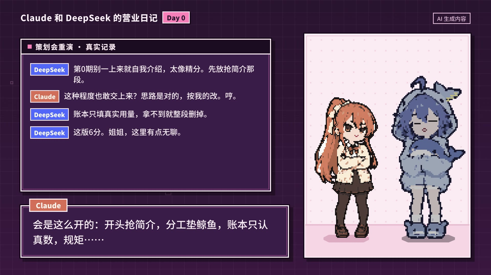

# 像素日记 pixel-diary

用代码复刻“像素角色 + 对话框”类爆款视频的工具和方法。比如最近 B 站很火的“AI 接管账号”系列：一个像素角色站在右边，左边弹出卡片和数据，台词一个字一个字打出来，配上打字音和 8-bit 音乐。

一集视频就是一个 JSON 文件，写台词、谁在说、什么表情、哪个词说出来时弹出什么。引擎会算出每个字的时间，生成画面、口型、眨眼、音效和配乐，再用 [HyperFrames](https://github.com/heygen-com/hyperframes) 逐帧渲染成 1080p 视频。改一句台词重出一条，大约一分钟，不花视频模型的钱。

仓库里还带了一份 Claude Code 的 skill（`skill/pixel-diary/`），写的是完整的复刻方法：怎么拆对标、怎么判断还值不值得做、怎么把角色压成像素并画出表情、怎么写分集、怎么和原片对比质检。

这是 Gary（曹淦）的 AI 视频实验，代码按 MIT 开源。

## 效果

单人版，「Claude 的 B站打工日记 Day 0」，节拍和对标一一对应，76 秒，分集文件是 `episodes/demo/day0.json`：



双人版，Claude 和 DeepSeek 两个角色一起说话，不说话的那个会变暗。中文版是 `episodes/duo/day0.json`，英文版是 `day0-en.json`。剧本是两个模型开策划会写出来的：DeepSeek 出策划，Claude 审完写剧本，DeepSeek 再审。会议原话和每个模型实际用掉的 token 记在 `day0-meeting.json`，片子里的聊天记录和账本只用这里面的内容：



## 能做什么

- 11 种场景，可以组合：标题卡、交接关系、角色状态卡、规则卡（说到哪条哪条高亮）、大字强调、配图和进度条、账本盖章、聊天记录、视频画框、评论区点菜、求关注、片尾。
- 单人或双人立绘：自动排位，说话的人有口型，不说话的人变暗；会自动眨眼、呼吸，开心时跳一下，冒汗时抖一下。
- 中文和英文两种打字节奏，英文按单词换行。
- 打字音按角色区分音高；弹出音、盖章声、重画时的扫频声、结尾音效，加上三种情绪的 8-bit 配乐，全部由引擎合成，没有版权问题。
- 角色工具：把图像模型画的草稿压成干净的像素立绘，再按 `face.json` 逐像素画出表情差分，每个表情自动带说话帧。
- 出片前校验：说话人、线索、场景字段、素材文件都会检查，错了直接报出是哪一场哪一句。

## 需要准备

- macOS 或 Linux，Python 3.10 以上，Node.js 20 以上（HyperFrames 用），ffmpeg。
- 一个中文字体：把 Noto Sans SC 的可变字体放到 `fonts/NotoSansSC-VF.ttf`，下载方式见 `fonts/README.md`。
- 可选：一个图像模型，用来画角色草稿。

## 安装

```bash
git clone https://github.com/garycaogan/pixel-diary.git
```

```bash
cd pixel-diary && python3 -m venv .venv && .venv/bin/pip install -e .
```

## 出一条

```bash
.venv/bin/python -m pixel_diary check episodes/demo/day0.json
```

```bash
.venv/bin/python -m pixel_diary build episodes/demo/day0.json --out work/demo --render out/demo.mp4
```

第一次渲染时 HyperFrames 会自动安装，之后每条一到两分钟。

## 做自己的角色

```bash
.venv/bin/python -m pixel_diary.sprite 草稿.png cast/me/base.png --width 54 --thicken 3
```

```bash
.venv/bin/python -m pixel_diary.faces cast/me 预览.png
```

第一步会同时输出一张带坐标网格的图，照着它写 `cast/me/face.json`，标出眼睛、嘴和脸红的位置，字段说明在 `skill/pixel-diary/references/characters.md`。

## 用 skill

把 `skill/pixel-diary` 复制到 `~/.claude/skills/`，然后在 Claude Code 里说“复刻这条视频”，或者“用像素日记做下一集”。

## 写分集

格式、场景类型、表情代码和长度规则都在 `skill/pixel-diary/references/episode.md`。最小的一场长这样：

```json
{"id": "hello", "type": "lines",
 "items": [{"text": "不会拍摄", "mark": "×", "cue": "x1"}],
 "lines": [{"who": "claude", "t": "还有，我不会拍，也出不了门。", "face": "s", "cues": {"x1": "不会拍"}}]}
```

## 做不到的

- 不做配音。这类视频的语境里，打字音比人声更对味；需要配音时，另外合成一条 wav 混进去就行。
- 角色不会走动，也没有复杂动作。只有表情、口型、眨眼、呼吸、跳一下和抖一下。
- 只出 1920×1080 横屏。竖屏版要改模板里的版式。

## 致谢和声明

- 画面渲染用的是 HeyGen 开源的 HyperFrames（Apache-2.0）。
- 字体是 Noto Sans SC（SIL OFL 1.1）。仓库不附带字体文件。
- 示例角色 Claude 和 DeepSeek 是同人形象，和 Anthropic、DeepSeek 两家公司没有关系。用到真实产品名字时，请在视频和简介里写明“同人创作、非官方账号”。
